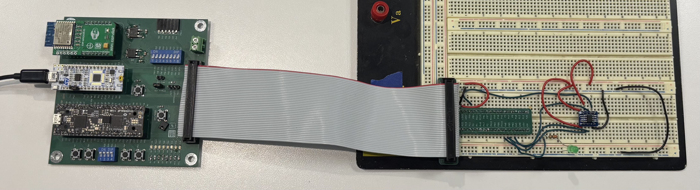
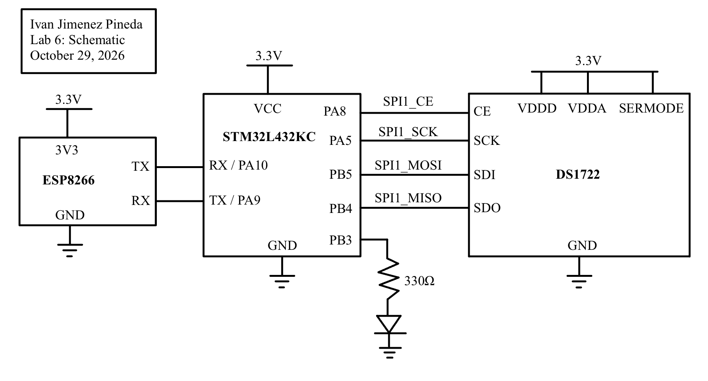
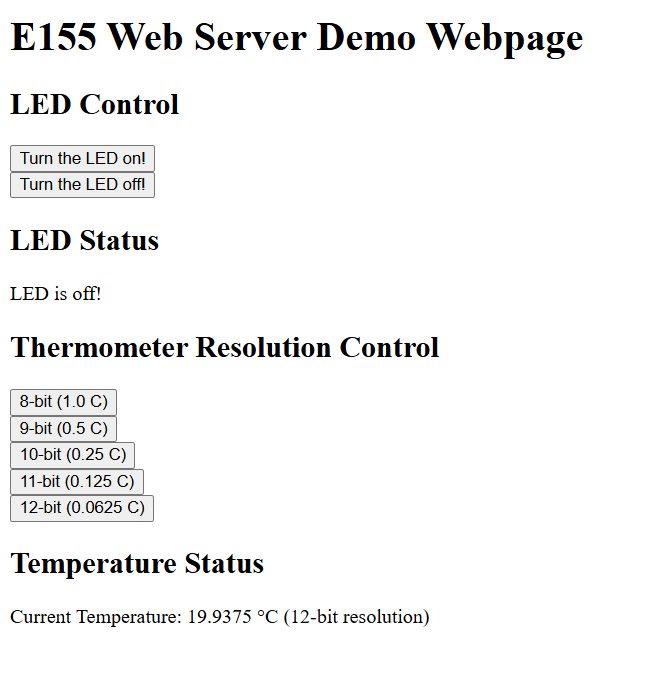
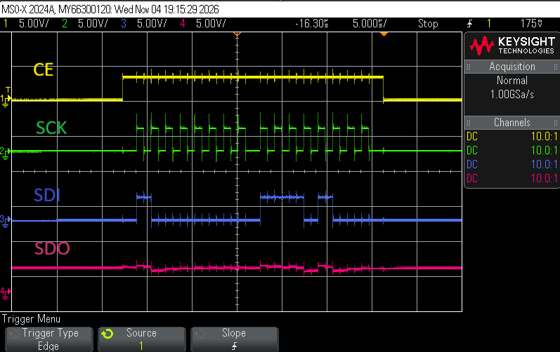
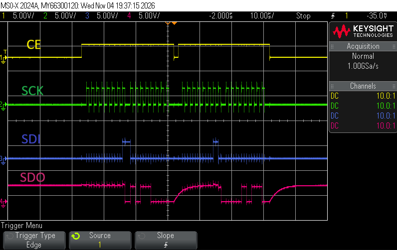

## Introduction
In Lab 6, an Internet of Things (IoT) device was designed and implemented using the STM32L432KC microcontroller, an ESP8266 WiFi module, and a DS1722 digital temperature sensor. The goal of this lab was to develop an embedded system capable of reading environmental data over a Serial Peripheral Interface (SPI) and serving it to a web interface over a USART connection. Users can interact with the webpage to toggle a hardware LED, select the temperature sensor's resolution (8 to 12 bits), and view real-time temperature updates.

*Figure 1: Complete wiring including the STM32L432KC, ESP8266 WiFi Module, and the DS1722 Temperature Sensor.*

## System Architecture and Hardware Design
The hardware for this lab consists of three main components:
1. **STM32L432KC MCU**: Acts as the central processor, managing the SPI and USART peripherals.
2. **ESP8266 WiFi Module**: Configured as an access point and web server. It communicates with the MCU via a 125000 baud USART link (with RX and TX lines crossed).
3. **DS1722 Digital Thermometer**: Interfaced with the MCU over SPI. The sensor requires an active-high Chip Enable (CE) and operates in continuous conversion mode.

### Schematic

*Figure 2: Schematic of the IoT Device.*

## Software and Microcontroller Design

### SPI Driver Implementation
A custom SPI driver was written using the CMSIS device templates to interface with the DS1722. 
- **Pins**: `PA5` (SCK), `PB4` (MISO), `PB5` (MOSI), and `PA8` (CE).
- **Configuration**: The SPI peripheral (`SPI1`) was configured for a 625 kHz clock (derived from the 80 MHz system clock). The DS1722 requires a clock phase (`CPHA`) of 1 and a clock polarity (`CPOL`) of 0. 
- **Data Handling**: The 8-bit FIFO reception threshold (`FRXTH`) was enabled to allow proper byte-by-byte transmission and reception using the `SPI1->DR` register. Software Slave Management (SSM) was utilized so the active-high CE pin could be controlled manually as a standard GPIO output.

### Temperature Conversion
The DS1722 outputs temperature as a 16-bit two's complement value. The MCU reads the LSB (`0x01`) and MSB (`0x02`) registers, concatenates them into a signed 16-bit integer, and divides by 256.0 to calculate the temperature in Celsius. This automatically handles both positive and negative temperatures across the sensor's full range.

### USART and Webserver Logic
The ESP8266 forwards HTTP requests to the MCU in the format `/REQ:<command>\n`. The MCU parses this string to:
- Update the LED state (e.g., `ledon`, `ledoff`).
- Update the DS1722 resolution (e.g., `res8` through `res12`) by writing to its configuration register (`0x80`).
After processing the request, the MCU generates an HTML string containing the current temperature, resolution, and LED status, and transmits it back to the ESP8266. State-tracking variables ensure the LED and resolution do not reset unexpectedly when the page is refreshed.

## Results and Testing

### Web Interface
The web interface successfully loads and displays the current temperature. Toggling the LED and changing the resolution updates the hardware and the webpage accurately.

*Figure 3: Webpage UI with different resolutions and temperatures.*

### SPI Logic Analyzer Capture
To verify the SPI protocol, an oscilloscope was used to capture a full SPI read transaction. The trace demonstrates the active-high CE, the clock idling low, and data being sampled on the correct clock edges (`CPHA=1`).

*Figure 4: Oscilloscope SPI Write Trace.*

*Figure 5: Oscilloscope SPI Read Trace.*

## AI Prototype Reflection

When comparing the LLM’s proficiency between frontend web development and low-level embedded C, it is clear that the AI is better at frontend web development. For the HTML prompt, the LLM instantly generated a highly polished, responsive dashboard complete with CSS styling, interactive toggle switches, and even a simulated `Chart.js` graph. Because web development relies on universal standards and flexible environments, the AI’s frontend output was structurally complete and visually impressive out of the box. Conversely, while the LLM correctly identified the DS1722's unique datasheet requirements—such as an active-high Chip Enable, `CPHA = 1`, and the $1/256^\circ\text{C}$ two's complement conversion its embedded C code was difficult to integrate. It rigidly hardcoded assumptions about the hardware (assigning SPI to `PA4`-`PA7` instead of the project's specific wiring) and used raw bit-shifting macros that didn't perfectly align with the STM32L432KC CMSIS templates.

Ultimately, the LLM served as a good conceptual guide, but a poor direct code generator for hardware specific tasks. Its detailed breakdown of the SPI initialization requirements and the scaling mathematics were incredibly helpful for verifying the driver's logic. However, the experience reinforced that while AI can practically write a web app for you, embedded systems require too much board-specific context such as shared pins, specific header macros, and register-level specifics to blindly trust AI-generated C code.

## Conclusion
The design meets all the requirements for Proficiency and Excellence. The IoT device successfully hosts a web server, controls hardware peripherals, and correctly parses two's complement SPI data across multiple resolutions.

**Hours Spent:** 19 Hours