## Introduction

In this lab, a hardware accelerator for 128-bit Advanced Encryption Standard was designed and implemented on an iCE40 UP5K FPGA, interfacing with an STM32L432KC microcontroller over Serial Peripheral Interface. Following the specifications outlined in the NIST FIPS-197 standard, the MCU transmits a 128-bit plaintext message and a 128-bit cipher key to the FPGA over SPI while asserting a `load` control signal. Once the transfer completes, the load signal is deasserted and the FPGA sequentially executes the ten rounds of the AES-128 algorithm byte substitution (`SubBytes`), row shifting (`ShiftRows`), column mixing (`MixColumns`), round key addition (`AddRoundKey`), and round key generation (`KeyExpansion`). Upon completion, the FPGA asserts a `done` flag and shifts the resulting 128-bit ciphertext back to the MCU over SPI, which verifies the output against the expected FIPS-197 Appendix B test vector and illuminates a status LED.

## Design and Testing Methodology

### System Architecture

Implementing all ten rounds of AES-128 combinationally would exceed the Lookup Table capacity of the iCE40 UP5K FPGA so a single round datapath is reused across ten sequential encryption rounds. To conserve logic cells, the S-Box byte substitutions (`sbox_sync`) are mapped to the FPGA's Embedded Block RAMs (EBRs) rather than combinational LUTs. Sixteen sbox_sync instances are used in parallel within `aes_sub_bytes` to substitute all 16 bytes of the 128-bit state simultaneously, and four sbox_sync instances are used within `aes_key_expansion` to perform the SubWord operation, consuming 20 of the 30 available EBR blocks on the iCE40 UP5K. Each round executes across two clock cycles:

1. **`WAIT` State**: The current 128-bit state (XORed with the round key via `aes_add_round_key`) and the rotated key word are presented to the address inputs of the 20 sbox_sync BRAM blocks.On the next rising clock edge, the substituted bytes are latched at the BRAM outputs.
2. **`CALC` State**: At the rising clock edge, `update_regs` asserts to latch `next_round_key` into `current_round_key` and `next_mixed_text` into `current_mixed_text` (and on Round 10, `shifted_text` into `round_10_shifted_text` to bypass `MixColumns` per FIPS-197 Section 5.1).

Using this two-cycle-per-round architecture, all ten rounds complete in 21 clock cycles after load is deasserted, after which the FSM enters the RETURN state and asserts done.

### MCU and FPGA SPI Interface

The provided MCU starter code configures SPI1 on pins `PB3` (`SCK`), `PB4` (`MISO`/`SDO`), and `PB5` (`MOSI`/`SDI`) with clock polarity CPOL = 0 and clock phase CPHA = 0. Pin `PA5` drives the `LOAD` signal, `PA6` monitors the `DONE` signal from the FPGA, `PA11` and `PA9` / `PA10` drive indicator LEDs for pass/fail verification. On the FPGA side, the internal high-speed oscillator (`HSOSC`) is configured with a divider of `2'b11` to supply a 6 MHz system clock (`clk`) to `aes_core`for the combinational path through `aes_row_shift` and `mixcolumns`.

### Block Diagram

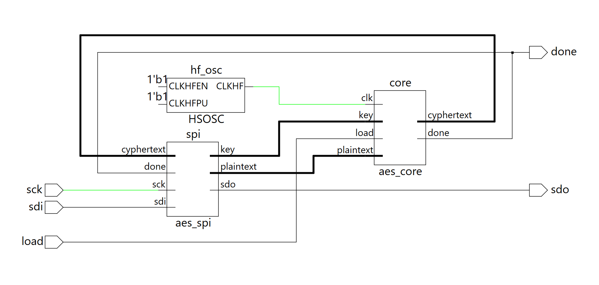
*Figure 1: Top-level and submodule hardware block diagram of the AES-128 FPGA accelerator.*

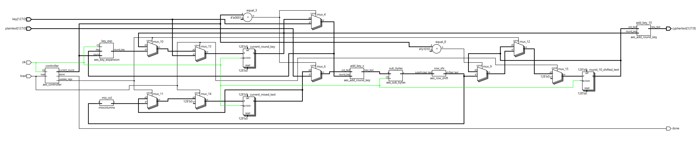
*Figure 1b: Block diagram of the aes_core module.*

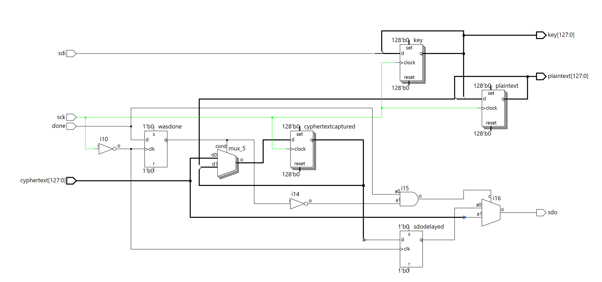
*Figure 1c: Block diagram of the aes_spi module.*

The top-level `lab7_ijp` instantiates the 6 MHz `HSOSC` , the `aes_spi` shift-register interface, and `aes_core`. Inside `aes_core`, control logic is isolated in `aes_controller`, which outputs `current_round`, `update_regs`, and `done`. Multiplexers select `key` and `plaintext` during Round 1 (`current_round == 4'd1`), and select the registered `current_round_key` and `current_mixed_text` during Rounds 2 through 10. A final `aes_add_round_key` instance (`add_key_10`) XORs `round_10_shifted_text` with Round 10's expanded key to produce the final `cyphertext`.

### Finite State Machine Design

*Figure 2: State transition diagram for `aes_controller`.*

As shown in Figure 2, `aes_controller` has four states:

* **`START` (`2'b00`)**: Entered synchronously whenever `load` is asserted. Initializes `current_round` to `1` and keeps `done` low. Transitions to `WAIT` once `load` is deasserted (`load == 0`).
* **`WAIT` (`2'b01`)**: Waits one clock cycle for the 20 synchronous `sbox_sync` EBR modules in `aes_sub_bytes` and `aes_key_expansion` to latch their substituted byte outputs. Unconditionally transitions to `CALC`.
* **`CALC` (`2'b10`)**: Asserts `update_regs = 1'b1` to capture the newly computed round key and mixed column state (or Round 10 shifted state) on the next clock edge, and increments `current_round`. Transitions back to `WAIT` if `current_round < 10`, or to `RETURN` when `current_round == 10`.
* **`RETURN` (`2'b11`)**: Holds `done = 1'b1` (with `current_round == 11`) so `aes_spi` can capture and shift out the final `cyphertext` to the MCU. Remains in `RETURN` until `load` is asserted for a new encryption request.

## Results and Discussion

### Testbench Simulation Waveforms

Each individual submodule was verified in QuestaSim against the official test vectors in FIPS-197 Appendix A.1 and Appendix B (`plaintext = 3243f6a8_885a308d_313198a2_e0370734`, `key = 2b7e1516_28aed2a6_abf71588_09cf4f3c`, `expected = 3925841d_02dc09fb_dc118597_196a0b32`).

#### `aes_core` Simulation

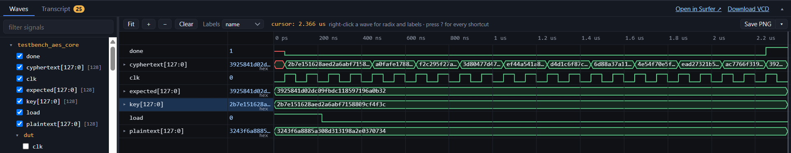
*Figure 3: Waveform for `aes_core_tb`, showing the progression through Rounds 1–10 and final assertion of `done` with `cyphertext` matching `expected` (`3925841d02dc09fbdc118597196a0b32`).*

##### `aes_key_expansion`

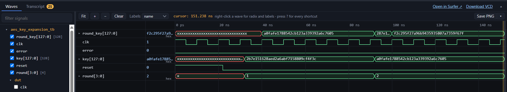
*Figure 4: `aes_key_expansion_tb` waveform verifying Round 1 (`a0fafe17_88542cb1_23a33939_2a6c7605`) and Round 2 (`f2c295f2_7a96b943_5935807a_7359f67f`) key schedule generation.*

##### `aes_add_round_key`

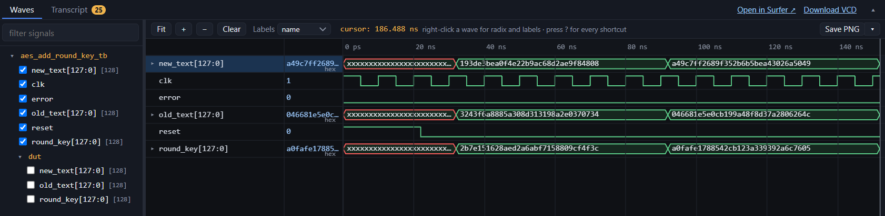
*Figure 5: `aes_add_round_key_tb` waveform verifying bitwise XOR round key addition.*

##### `aes_sub_bytes` & `sbox_sync`

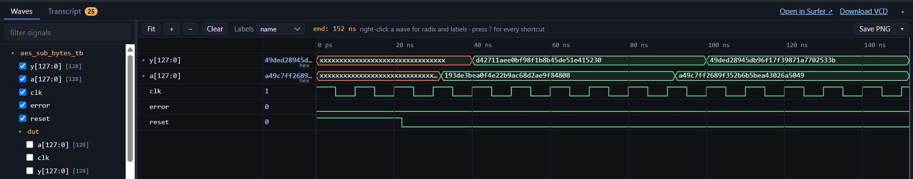
*Figure 6: `aes_sub_bytes_tb` waveform demonstrating synchronous 1-cycle BRAM S-Box byte substitution.*

##### `aes_row_shift`

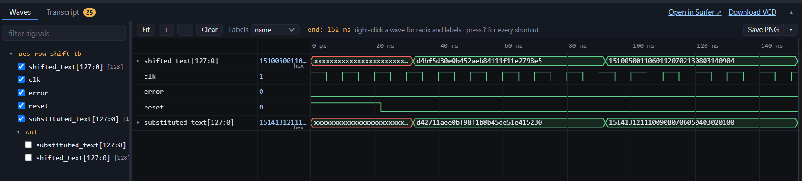
*Figure 7: `aes_row_shift_tb` waveform verifying cyclic left-shifting of rows 0 through 3.*

##### `galoismult`, `mixcolumn`, and `mixcolumns`

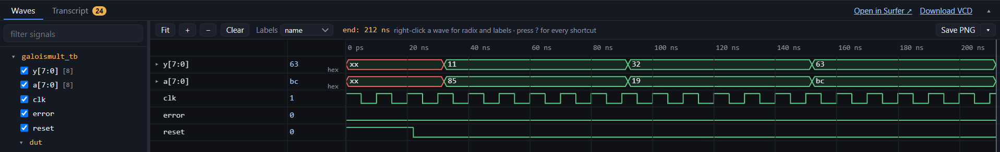
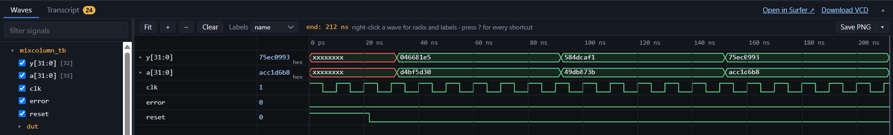
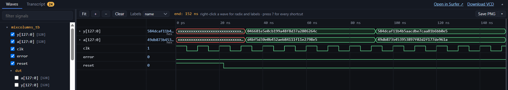

*Figure 8: Waveforms for `galoismult`, single-column `mixcolumn`, and 128-bit `mixcolumns` against FIPS-197 Appendix B Round 1 and Round 2 intermediate states.*

##### `aes_controller`

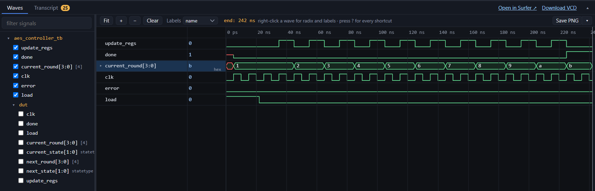
*Figure 9: `aes_controller_tb` waveform verifying state transitions (`START`, `WAIT`, `CALC`, `RETURN`), `update_regs`, and `done` assertion at `current_round == 11`.*

##### Full System (`aes_spi_tb`)

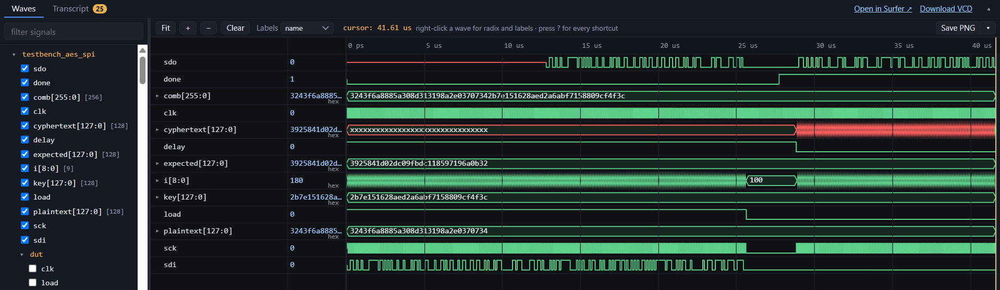
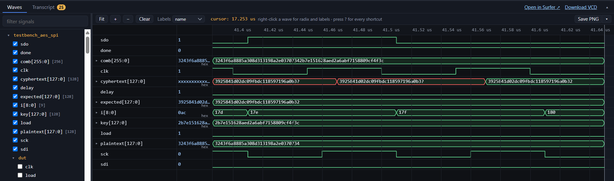
*Figure 10: Full-system `aes_spi_tb` waveforms showing the 256-bit SPI shift-in while `load` is high, AES encryption, `done` assertion, and 128-bit SPI shift-out of the verified ciphertext.*

### Oscilloscope Traces

The design was synthesized in Lattice Radiant and deployed onto the iCE40 UP5K alongside the STM32L432KC running `lab7.c`. Upon execution, the MCU's success indicator LED (`PA9`) illuminated for both the FIPS-197 Appendix B and Appendix C.1 test vectors, confirming end-to-end hardware-accelerated encryption.

*Figure 11: Hardware setup showing indicator LED illuminated on successful ciphertext verification.*

*Figure 12: Oscilloscope trace of the SPI Write transaction (`LOAD` asserted, MCU transmitting `plaintext` and `key` over `MOSI`).*

*Figure 13: Oscilloscope trace of the SPI Read transaction (`DONE` asserted, FPGA returning encrypted `cyphertext` over `MISO`).*

---

## AI Prototype Reflection

**Output Quality & Approach:** 

**(Prompt 1):** When given the explicit FIPS-197 context, the LLM generated a highly specific, ready-to-use AES-128 `KeyExpansion` module. It correctly inferred the 10 rounds, hardcoded the exact `Rcon` values in a `case` statement, and implemented a clean, sequential XOR chain.

**(Prompt 2):** When provided only generic pseudocode, the LLM took a much more parameterized approach. It utilized `generate` `for` loops, `genvar`, and parameters (`Nk`, `Nr`) to unroll the logic. It also correctly inferred that the `Rcon` values would need to be supplied as an external array since it lacked the context of what those constants should be. The second prompt forced the LLM to use `generate` and `genvar` loops.

**Synthesis:** Prompt 1 correctly synthesized but Prompt 2 did not. The LLM's output for Prompt 2 was a generic, parameterized module that would require additional context to synthesize correctly. Prompt 1's output was a complete, synthesizable module that could be directly integrated into the larger AES datapath.

---

## Conclusion

The hardware accelerated AES-128 encryption system met all Proficiency and Excellence specifications for Lab 7. All individual module testbenches, core simulations, full-system SPI simulations, and physical hardware logic analyzer verifications passed with zero errors.

* **Requirement Status**: All Proficiency and Excellence requirements for simulation, Verilog structure/style, block diagrams, and hardware execution were fully met.
* **Time Spent**: 19 Hours