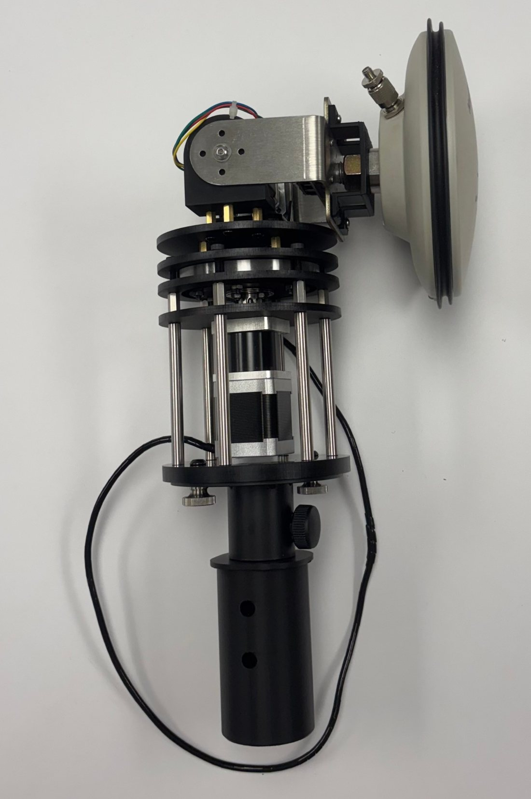
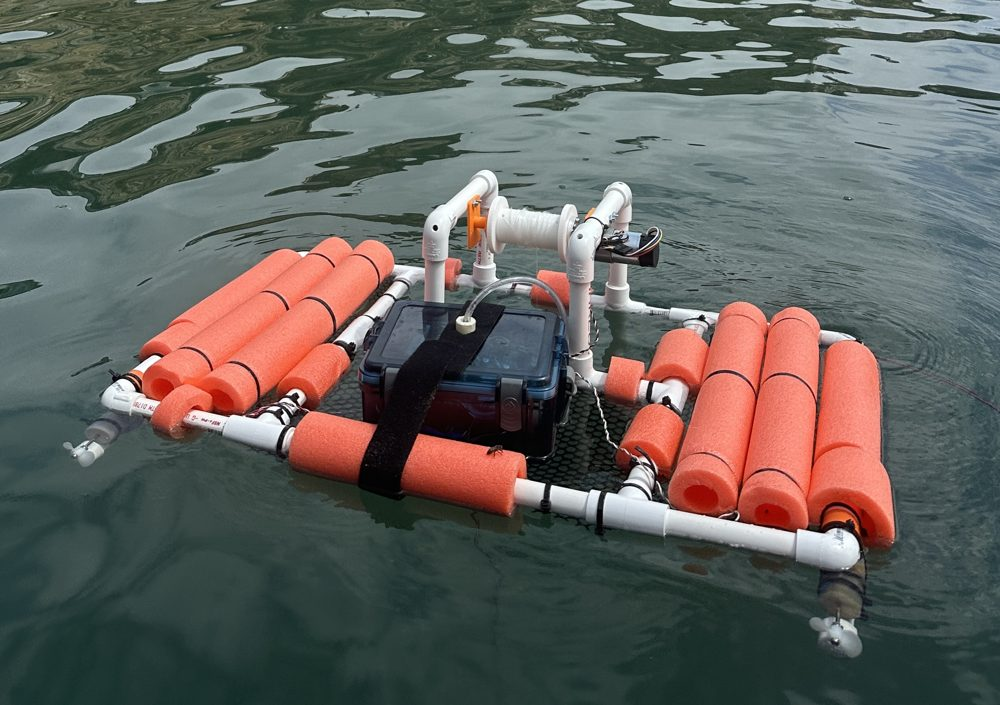
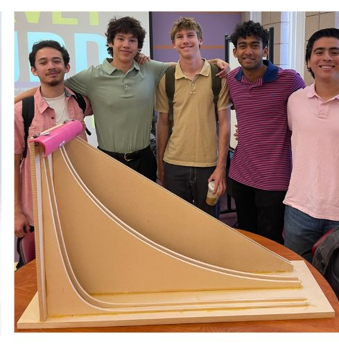
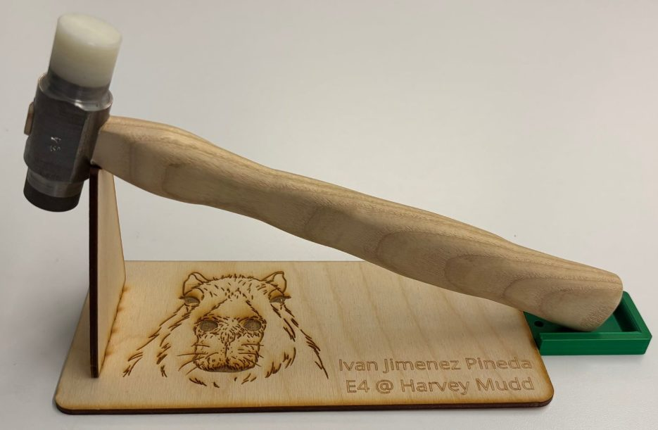
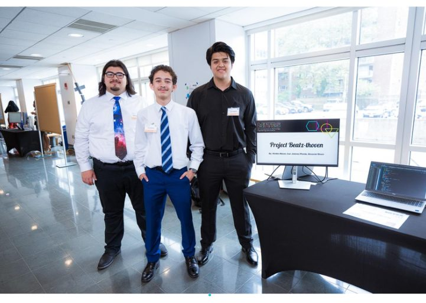

:::: {.cs-card}
::: {.cs-media}
[{fig-alt="FRPA antenna mounted on the AntRunner positioner"}](project_clinic.qmd)
:::
::: {.cs-body}
[In Progress]{.status .status--progress} [Sep 2026 – Present]{.meta-date}

### Automating Antenna Pattern Testing {#clinic}

**Context** Harvey Mudd Engineering Clinic for The Aerospace Corporation and the FAA: characterizing a GPS anti-jamming CRPA in an anechoic chamber.

**My Role** Lead for automating the AntRunner positioner. I write the Python script that runs on a Raspberry Pi and sends commands to the positioner's ESP32. I also built the wooden mount for our manual baseline test.

**Outcome so far** The automated sweep produced a more symmetric, consistent radiation pattern than the hand-rotated test.

[Python]{.tag} [Raspberry Pi]{.tag} [ESP32]{.tag} [VNA]{.tag} [Test Automation]{.tag}

[Read the Case Study →](project_clinic.qmd){.btn .btn-primary}
:::
::::

:::: {.cs-card}
::: {.cs-media}
[{fig-alt="The robot on the water at Dana Point Harbor"}](project_auv.qmd)
:::
::: {.cs-body}
[Completed]{.status .status--done} [Aug 2025 – May 2026]{.meta-date}

### Autonomous Underwater Vehicle {#autonomous-underwater-vehicle}

**Context** E80: Experimental Engineering team project. A low-cost robot that measures light, temperature, and depth at Dana Point Harbor.

**My Role** I designed the op-amp sensor-interface circuits, wrote the Teensy logging code, did the MATLAB calibration, and helped build the robot and its winch.

**Outcome** Lowered the payload to 1.84 m and measured light falling from about 100,000 to 88,000 lux. Saltwater shorted the thermistor, which taught us a hard lesson about waterproofing.

[Op-Amps]{.tag} [Teensy]{.tag} [MATLAB]{.tag} [CAD]{.tag} [Field Testing]{.tag}

[Read the Case Study →](project_auv.qmd){.btn .btn-primary} [Report (PDF)](E80_Final_Report_Ivan_Jimenez_Pineda.pdf){.btn .btn-outline-primary target="_blank"}
:::
::::

:::: {.cs-card}
::: {.cs-media}
[{fig-alt="Finished brachistochrone model with the team"}](project_brachistochrone.qmd)
:::
::: {.cs-body}
[Completed]{.status .status--done} [Feb 2025 – May 2025]{.meta-date}

### Brachistochrone Curve Model {#brachistochrone-curve-model}

**Context** Team project for a client who requested a physics demonstration of the fastest path of descent.

**My Role** I modeled the descent paths in SolidWorks with equation-driven curves and cut the ramps and corner fixtures on a CNC router.

**Outcome** A finished race-track model where three balls released together race down three different paths.

[SolidWorks]{.tag} [CNC Router]{.tag} [Fixturing]{.tag}

[Read the Case Study →](project_brachistochrone.qmd){.btn .btn-primary}
:::
::::

:::: {.cs-card}
::: {.cs-media}
[{fig-alt="Finished machinist's hammer"}](project_hammer.qmd)
:::
::: {.cs-body}
[Completed]{.status .status--done} [Mar 2025 – Apr 2025]{.meta-date}

### The Machinist's Hammer {#the-machinists-hammer}

**Context** Harvey Mudd machine shop project, built individually.

**My Role** I machined every part in AISI 4340 and 1015 steel, heat treated the hard face, and verified its hardness.

**Outcome** Heat treated at 857 °C, measuring RC 43–48 on a Rockwell tester. I now teach this same project as a shop proctor.

[Mill]{.tag} [Lathe]{.tag} [Heat Treatment]{.tag} [Rockwell Testing]{.tag}

[Read the Case Study →](project_hammer.qmd){.btn .btn-primary}
:::
::::

:::: {.cs-card}
::: {.cs-media}
{fig-alt="Project Beatzthoven team at the MITES symposium"}
:::
::: {.cs-body}
[Completed]{.status .status--done} [Jun 2023 – Jul 2023]{.meta-date}

### MITES Summer Scholar Symposium Project {#mites-summer-scholar-symposium-project}

**Context** MIT MITES summer program. A team software project built in a strict 6-week cycle and presented at an MIT showcase.

**My Role** I co-developed "Project Beatzthoven," an interactive Python machine-learning app that algorithmically generates classical music with Markov chain logic.

**Why it matters** It's where I built my debugging habits and learned to balance competing priorities on a fixed deadline.

[Python]{.tag} [Markov Chains]{.tag} [Teamwork]{.tag}
:::
::::
