```{=html}
<div class="hx">

<!-- =============================== HERO =============================== -->
<section class="hx-hero">
  <div class="hx-photo hx-glass" data-tilt>
    
    <span class="hx-badge hx-badge--tl"><i class="bi bi-geo-alt-fill"></i> Claremont, CA</span>
    <span class="hx-badge hx-badge--br"><i class="bi bi-lightning-charge-fill"></i> Electro-Mechanical</span>
  </div>

  <div class="hx-intro hx-glass">
    <p class="hx-eyebrow">Engineering @ Harvey Mudd College</p>
    <h1 class="hx-name">Ivan Jimenez Pineda</h1>
    <p class="hx-role">Electro-Mechanical &amp; Manufacturing Engineering</p>
    <p class="hx-typed">I build <span id="typed-role">hardware.</span><span class="hx-cursor">|</span></p>
    <p class="hx-bio">
      I love building and testing hardware, from analog signal-conditioning circuits for an
      autonomous underwater vehicle to machining custom fixtures for antenna characterization
      with the FAA and The Aerospace Corporation. Enjoy write-ups of my projects, labs, and
      experience below!
    </p>
    <div class="hx-chips">
      <span><i class="bi bi-people-fill"></i> Co-President, SALSA Mudd</span>
      <span><i class="bi bi-tools"></i> Machine Shop Proctor</span>
      <span><i class="bi bi-gear-fill"></i> ME Intern @ ALLFAST</span>
    </div>
    <div class="hx-actions">
      <a class="hx-btn hx-btn--dark" href="#projects">View Projects <i class="bi bi-arrow-down"></i></a>
      <a class="hx-btn hx-btn--gold" href="#resume">Resume <i class="bi bi-file-earmark-text"></i></a>
      <a class="hx-icon" href="https://www.linkedin.com/in/ivan-jimenez-pineda/" target="_blank" rel="noopener" aria-label="LinkedIn"><i class="bi bi-linkedin"></i></a>
      <a class="hx-icon" href="https://github.com/IvanJimenezPineda4" target="_blank" rel="noopener" aria-label="GitHub"><i class="bi bi-github"></i></a>
    </div>
  </div>
</section>

<!-- =============================== EXPERIENCE CAROUSEL =============================== -->
<section id="experience" class="hx-section">
  <h2 class="hx-h2">Work Experience</h2>
  <p class="hx-sub">Drag, swipe, or hover to pause. Click a card for details.</p>

  <div class="hx-carousel" aria-label="Work experience">
    <div class="hx-track">
      <a class="hx-xp" href="professional_experience.html#crpa">
        <div class="hx-xp__inner hx-glass">
          <div class="hx-xp__img hx-xp__img--logo"></div>
          <p class="hx-xp__role">CRPA Characterization Clinic</p>
          <p class="hx-xp__org">The Aerospace Corp. / FAA</p>
          <p class="hx-xp__text">Leading Python automation of the AntRunner positioner via Raspberry Pi and ESP32, plus machined fixtures and VNA RF tests for a GPS anti-jamming CRPA.</p>
          <span class="hx-xp__date">SEP 2026 — PRESENT</span>
        </div>
      </a>
      <a class="hx-xp" href="professional_experience.html#allfast">
        <div class="hx-xp__inner hx-glass">
          <div class="hx-xp__img">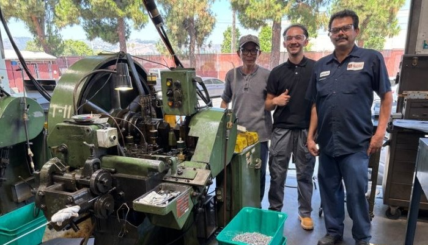</div>
          <p class="hx-xp__role">Mechanical Engineering Intern</p>
          <p class="hx-xp__org">ALLFAST Fastening Systems</p>
          <p class="hx-xp__text">Created 65 SolidWorks tooling layouts supporting a 224M+ part production backlog and updated ERP BOMs.</p>
          <span class="hx-xp__date">MAY 2026 — AUG 2026</span>
        </div>
      </a>
      <a class="hx-xp" href="professional_experience.html#machine-shop">
        <div class="hx-xp__inner hx-glass">
          <div class="hx-xp__img">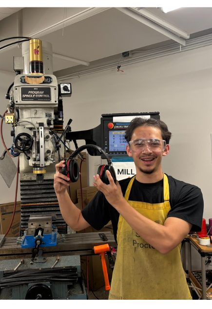</div>
          <p class="hx-xp__role">Machine Shop Proctor</p>
          <p class="hx-xp__org">Harvey Mudd College</p>
          <p class="hx-xp__text">Train students on mills, lathes, and CNC routers to tolerances of 0.001", plus drawings and GD&amp;T.</p>
          <span class="hx-xp__date">MAY 2025 — PRESENT</span>
        </div>
      </a>
      <a class="hx-xp" href="get_to_know_me.html">
        <div class="hx-xp__inner hx-glass">
          <div class="hx-xp__img"></div>
          <p class="hx-xp__role">Co-President</p>
          <p class="hx-xp__org">SALSA Mudd</p>
          <p class="hx-xp__text">Lead weekly meetings and events uplifting the Latinx community at Harvey Mudd, from carne asadas to career prep.</p>
          <span class="hx-xp__date">LEADERSHIP</span>
        </div>
      </a>
    </div>
  </div>

  <a class="hx-skate" href="#projects" aria-label="Explore more: scroll to projects">
    <svg viewBox="0 0 460 190" role="img" aria-hidden="true">
      <line class="sk-ground" x1="20" y1="166" x2="440" y2="166"/>
      <g class="sk-drift">
        <g class="sk-ollie">
          <g class="sk-speed">
            <path d="M-78 100 H-52"/><path d="M-90 116 H-56"/><path d="M-74 132 H-50"/>
          </g>
          <g class="sk-bubble">
            <path class="sk-bubble__box" d="M34 16 H170 A12 12 0 0 1 182 28 V50 A12 12 0 0 1 170 62 H42 L24 72 L30 60 A12 12 0 0 1 22 50 V28 A12 12 0 0 1 34 16 Z"/>
            <text x="102" y="45" text-anchor="middle">Explore more &#8595;</text>
          </g>
          <g class="sk-body">
            <circle class="sk-ink" cx="7" cy="67" r="11"/>
            <path class="sk-ink" d="M0 112 L4 80"/>
            <path class="sk-ink" d="M4 86 L-12 96 L-26 90"/>
            <path class="sk-ink" d="M4 86 L20 98 L29 114"/>
            <path class="sk-ink sk-finger" d="M29 114 L31 124"/>
            <path class="sk-ink" d="M0 112 L-14 130 L-20 147"/>
            <path class="sk-ink" d="M0 112 L12 128 L17 147"/>
          </g>
          <path class="sk-ink" d="M-40 144 Q-36 151 -28 151 L28 151 Q36 151 40 144"/>
          <g class="sk-wheel"><circle cx="-20" cy="158" r="7"/><path d="M-20 153 V163"/></g>
          <g class="sk-wheel"><circle cx="20" cy="158" r="7"/><path d="M20 153 V163"/></g>
        </g>
      </g>
    </svg>
  </a>
</section>

<!-- =============================== PROJECTS =============================== -->
<section id="projects" class="hx-section">
  <h2 class="hx-h2">Engineering Projects</h2>

  <article class="hx-proj hx-glass">
    <div class="hx-proj__body">
      <p class="hx-proj__date">AUG 2025 — MAY 2026</p>
      <h3>Autonomous Underwater Vehicle</h3>
      <div class="hx-tags"><span>Analog Circuits</span><span>Teensy</span><span>MATLAB</span><span>Build</span></div>
      <p>Engineered a low-cost autonomous robot with a custom winch that deploys a tethered sensor payload. Designed op-amp signal conditioning for a thermistor, pressure sensor, and solar cell, then logged depth-resolved data at Dana Point Harbor.</p>
      <a class="hx-btn hx-btn--gold" href="engineering_projects.html#autonomous-underwater-vehicle">View More <i class="bi bi-arrow-right"></i></a>
    </div>
    <a class="hx-proj__media" href="engineering_projects.html#autonomous-underwater-vehicle" tabindex="-1">
      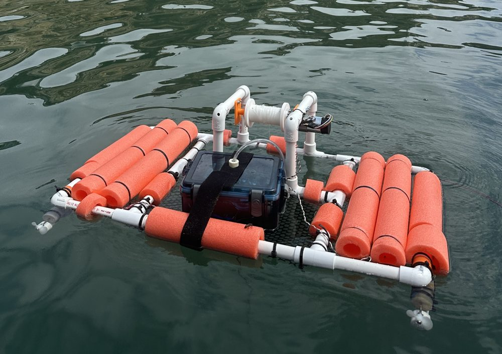
    </a>
  </article>

  <article class="hx-proj hx-glass">
    <div class="hx-proj__body">
      <p class="hx-proj__date">MAR 2025 — APR 2025</p>
      <h3>The Machinist's Hammer</h3>
      <div class="hx-tags"><span>Mill</span><span>Lathe</span><span>Heat Treatment</span><span>Build</span></div>
      <p>Machined a multi-material alloy steel hammer (AISI 4340 &amp; 1015) with a hard face, soft face, handle, and stand. Heat treated the hard face at 857 °C and verified RC 43–48 on a Rockwell tester.</p>
      <a class="hx-btn hx-btn--gold" href="engineering_projects.html#the-machinists-hammer">View More <i class="bi bi-arrow-right"></i></a>
    </div>
    <a class="hx-proj__media" href="engineering_projects.html#the-machinists-hammer" tabindex="-1">
      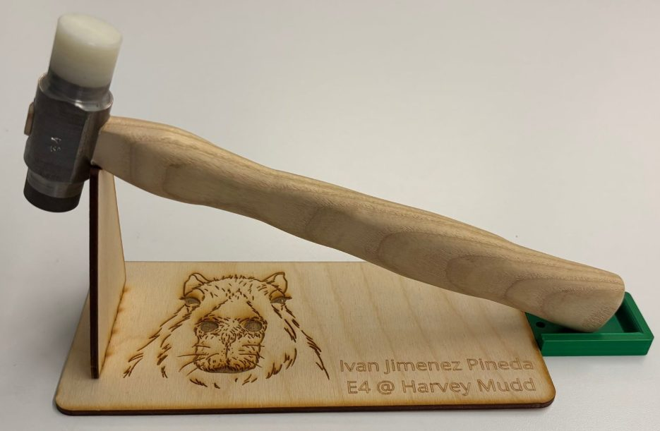
    </a>
  </article>

  <article class="hx-proj hx-glass">
    <div class="hx-proj__body">
      <p class="hx-proj__date">FEB 2025 — MAY 2025</p>
      <h3>Brachistochrone Curve Model</h3>
      <div class="hx-tags"><span>SolidWorks</span><span>CNC Router</span><span>Physics Demo</span></div>
      <p>Modeled cycloid, linear, and parabolic descent paths with equation-driven curves for a client physics demonstration, then cut the ramps and custom corner fixtures on a CNC router.</p>
      <a class="hx-btn hx-btn--gold" href="engineering_projects.html#brachistochrone-curve-model">View More <i class="bi bi-arrow-right"></i></a>
    </div>
    <a class="hx-proj__media" href="engineering_projects.html#brachistochrone-curve-model" tabindex="-1">
      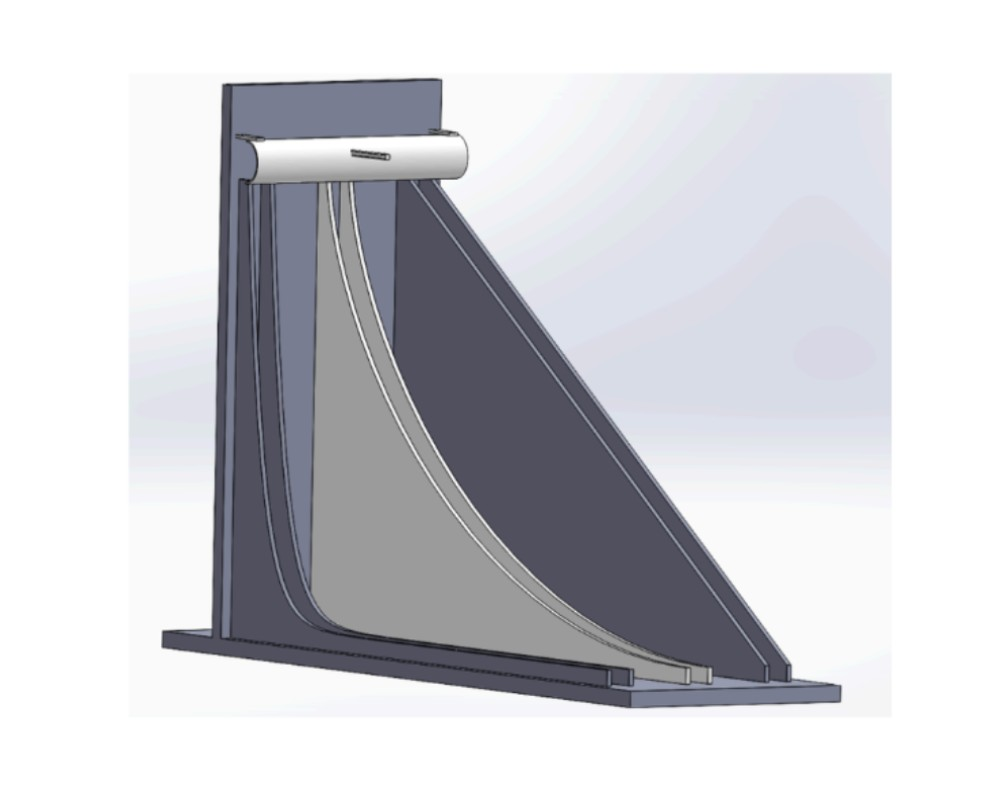
    </a>
  </article>

  <article class="hx-proj hx-glass">
    <div class="hx-proj__body">
      <p class="hx-proj__date">JUN 2023 — JUL 2023</p>
      <h3>Project Beatzthoven</h3>
      <div class="hx-tags"><span>Python</span><span>Machine Learning</span><span>MIT MITES</span></div>
      <p>Co-developed an interactive machine-learning app that generates classical music with Markov chains, built in a six-week cycle and presented at the MIT MITES symposium.</p>
      <a class="hx-btn hx-btn--gold" href="engineering_projects.html#mites-summer-scholar-symposium-project">View More <i class="bi bi-arrow-right"></i></a>
    </div>
    <a class="hx-proj__media" href="engineering_projects.html#mites-summer-scholar-symposium-project" tabindex="-1">
      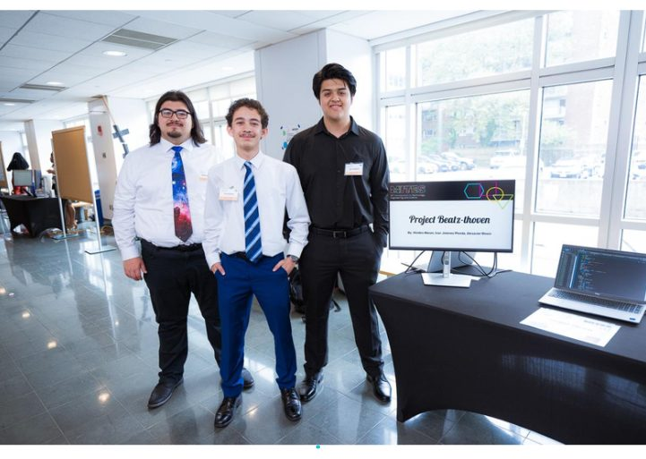
    </a>
  </article>
</section>

<!-- =============================== LABS RAIL =============================== -->
<section id="labs" class="hx-section">
  <div class="hx-rail-head">
    <div>
      <h2 class="hx-h2 hx-h2--left">Microprocessor Labs</h2>
      <p class="hx-sub hx-sub--left">E155 at Harvey Mudd: FPGAs, MCUs, and lots of debugging.</p>
    </div>
    <div class="hx-rail-btns">
      <button class="hx-rail-btn" data-dir="-1" aria-label="Scroll labs left"><i class="bi bi-chevron-left"></i></button>
      <button class="hx-rail-btn" data-dir="1" aria-label="Scroll labs right"><i class="bi bi-chevron-right"></i></button>
    </div>
  </div>

  <div class="hx-rail">
    <a class="hx-lab hx-glass" href="LAB1.html"><div class="hx-lab__img">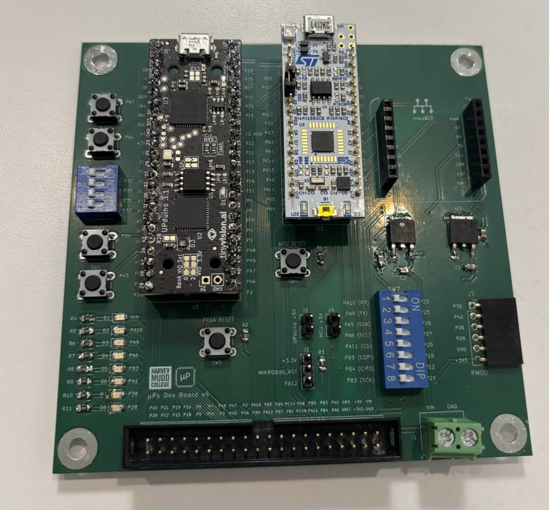</div><div class="hx-lab__body"><span>Lab 1</span><h3>FPGA &amp; MCU Setup</h3><p>Assembled the dev board and drove LEDs and a hex 7-segment decoder in SystemVerilog.</p></div></a>
    <a class="hx-lab hx-glass" href="LAB2.html"><div class="hx-lab__img">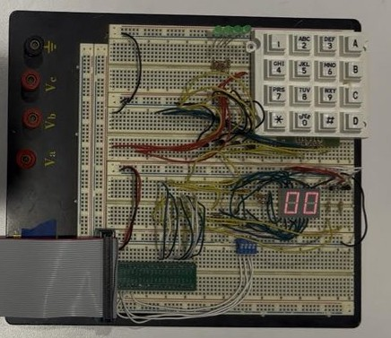</div><div class="hx-lab__body"><span>Lab 2</span><h3>Multiplexed Display</h3><p>Time-multiplexed two hex digits on a dual 7-segment display with one decoder.</p></div></a>
    <a class="hx-lab hx-glass" href="LAB3.html"><div class="hx-lab__img">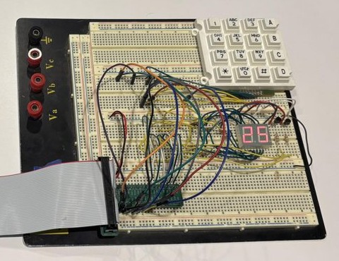</div><div class="hx-lab__body"><span>Lab 3</span><h3>Keypad Scanner</h3><p>Debounced 4x4 keypad scanner FSM that handles multi-press edge cases.</p></div></a>
    <a class="hx-lab hx-glass" href="LAB4.html"><div class="hx-lab__img">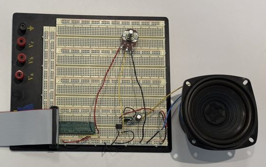</div><div class="hx-lab__body"><span>Lab 4</span><h3>Digital Audio</h3><p>STM32 timer-driven PWM synthesizer playing <em>Für Elise</em> through an LM386 amp.</p></div></a>
    <a class="hx-lab hx-glass" href="LAB5.html"><div class="hx-lab__img">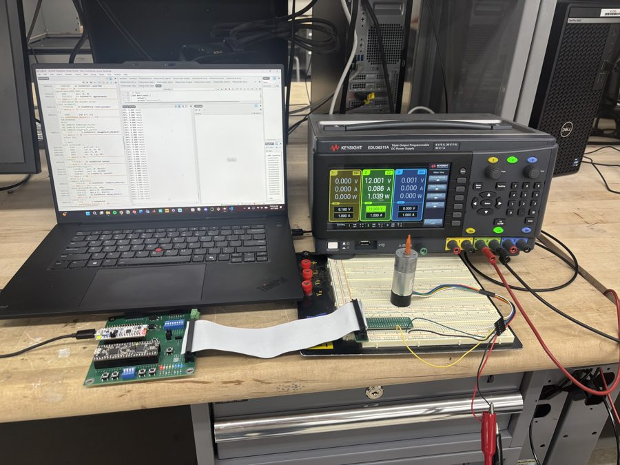</div><div class="hx-lab__body"><span>Lab 5</span><h3>Interrupts</h3><p>Quadrature-encoder motor speed and direction measured with edge-triggered interrupts.</p></div></a>
    <a class="hx-lab hx-glass" href="LAB6.html"><div class="hx-lab__img">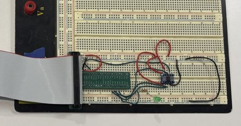</div><div class="hx-lab__body"><span>Lab 6</span><h3>IoT &amp; SPI</h3><p>DS1722 temperature sensor over SPI, served to a web page through an ESP8266.</p></div></a>
    <a class="hx-lab hx-glass" href="LAB7.html"><div class="hx-lab__img">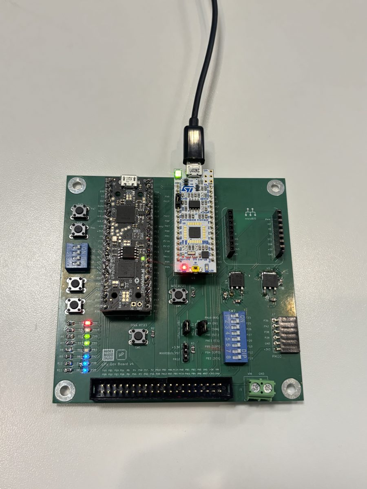</div><div class="hx-lab__body"><span>Lab 7</span><h3>AES Encryption</h3><p>AES-128 hardware accelerator on an iCE40 FPGA, fed by the MCU over SPI.</p></div></a>
  </div>
</section>

<!-- =============================== RESUME =============================== -->
<section id="resume" class="hx-section">
  <div class="hx-resume hx-glass reveal">
    <div class="hx-resume__head">
      <div>
        <h2 class="hx-h2 hx-h2--left">Resume</h2>
        <p class="hx-sub hx-sub--left">Everything in one page.</p>
      </div>
      <div class="hx-actions">
        <a class="hx-btn hx-btn--dark" href="RESUME.pdf" target="_blank" rel="noopener">Open in New Tab <i class="bi bi-box-arrow-up-right"></i></a>
        <a class="hx-btn hx-btn--gold" href="RESUME.pdf" download>Download <i class="bi bi-download"></i></a>
      </div>
    </div>
    <iframe src="RESUME.pdf" title="Ivan Jimenez Pineda resume"></iframe>
  </div>
</section>

<!-- =============================== GET TO KNOW ME =============================== -->
<section class="hx-section hx-section--last">
  <div class="hx-cta hx-glass reveal">
    <div>
      <h2>There's more to me than engineering!</h2>
      <p>Skateboarding, SALSA Mudd, trips to Mexico, Disneyland, and one very evil-looking CVS.</p>
    </div>
    <a class="hx-btn hx-btn--dark" href="get_to_know_me.html">Get to Know Me! <i class="bi bi-emoji-smile"></i></a>
  </div>
</section>

</div>
<script src="home.js"></script>
```
