:::: {.glance}
::: {.glance-item}
[Context]{.glance-k}
Class project for E80: Experimental Engineering at Harvey Mudd (Aug 2025 – May 2026). Team of 4.
:::
::: {.glance-item}
[My Role]{.glance-k}
Analog sensor-interface circuits, Teensy data-logging code, MATLAB calibration, and building and assembling the robot and its sensor payload.
:::
::: {.glance-item}
[Tools]{.glance-k}
Op-amp circuit design · Teensy / Arduino IDE · MATLAB · CAD · 3D printing · Epoxy waterproofing
:::
::: {.glance-item}
[Status]{.glance-k}
[Completed]{.status .status--done}
<br>[Design]{.skill .skill--design} [Build]{.skill .skill--build} [Analyze]{.skill .skill--analyze} [Iterate]{.skill .skill--iterate} [Communicate]{.skill .skill--communicate}
:::
::::

## Context

How much sunlight reaches different depths in the water is a measure of water clarity and suspended pollution, both important for underwater ecosystems. Our task was to design a **low-cost autonomous robot** that could go to Dana Point Harbor and measure **light, temperature, and depth** at several depths.

**Parameters we had to design around:**

* a target depth of about 2 m,
* sensor outputs that fit the Teensy's 0–3.3 V analog inputs,
* waterproof electronics,
* a robot that stays upright and holds position on the surface.

## My Role

This was a four-person team project. My contributions:

* **Sensor-interface electronics.** I designed analog signal-conditioning circuits with unity-gain buffers and inverting offset op-amps. They connect an NTC thermistor, a pressure sensor, and an amorphous silicon solar cell to the Teensy microcontroller.
* **Firmware and data.** I programmed the Teensy in the Arduino IDE for synchronized sensor logging. I then used MATLAB to calibrate the raw data and plot light and temperature against depth.
* **Build & assembly.** I worked on building and assembling the robot and the sensor payload, including the custom winch mechanism that deploys the tethered payload.

## What We Built

A positively buoyant PVC surface robot carries a negatively buoyant sensor payload. A motorized winch lowers the payload in steps, so the robot can stay on the surface while it collects data vertically.

:::: {.media-grid}
::: {}
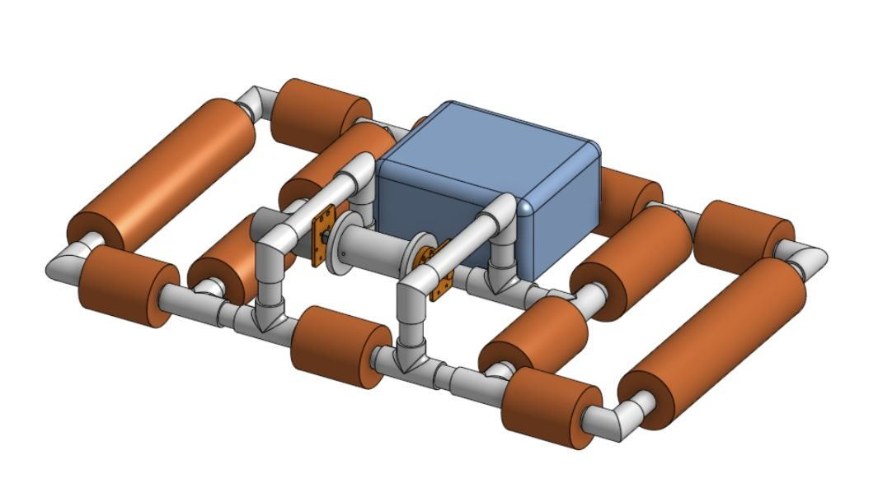
:::
::: {}
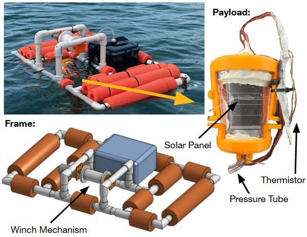
:::
::: {}
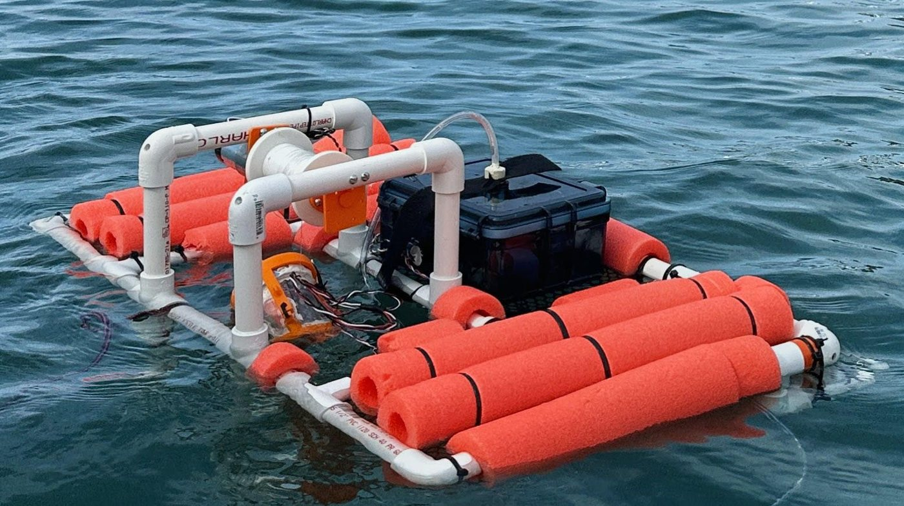
:::
::::

```{=html}
<div class="video-frame">
  <video controls muted playsinline preload="metadata" poster="images/projects/auv/tank_video_poster.jpg">
    <source src="videos/auv_tank_test.mp4" type="video/mp4">
  </video>
</div>
<p class="video-cap">Tank test: the winch lowers the tethered sensor payload and reels it back up.</p>
```

## How We Built It

### 1. Sensor circuits (sketches & schematics)

The pressure sensor only swings about 0.16 V over our 2 m depth range. I used a **unity-gain buffer followed by an inverting offset amplifier (gain −11.5)** to stretch that small signal across most of the ADC's range. The thermistor uses a voltage divider with the same buffer-and-amplifier approach.

:::: {.media-grid}
::: {}
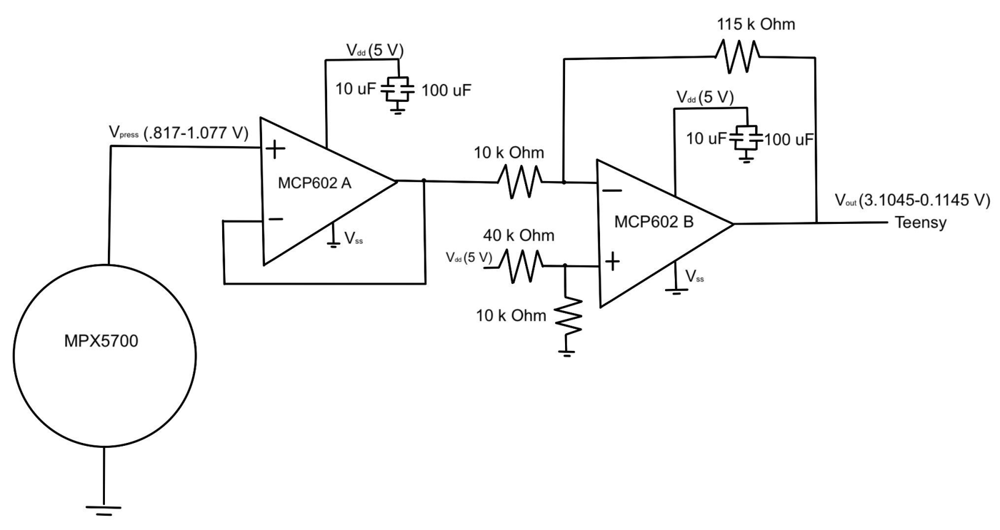
:::
::: {}
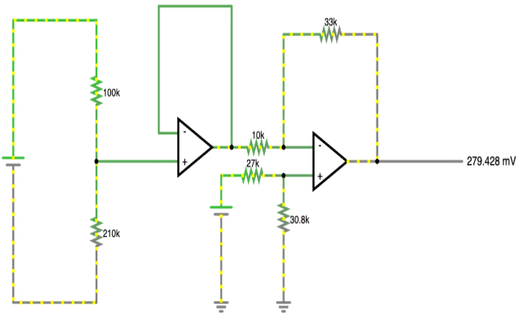
:::
::::

### 2. Calibration

* **Pressure sensor:** we taped its tube to a yardstick and recorded voltages at known depths, then fit a linear model (R² = 0.999).
* **Thermistor:** we measured it in six temperature baths for a linear resistance-vs-temperature fit (R² = 0.997).
* **Solar cell:** its open-circuit voltage is logarithmic in light, so we calibrated an exponential lux model against a lux meter.

:::: {.media-grid}
::: {}
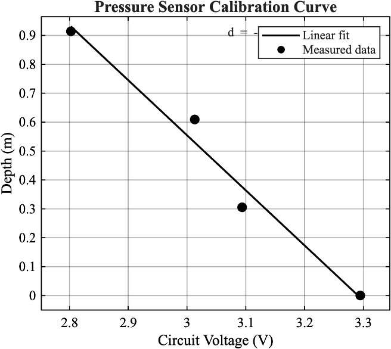
:::
::: {}
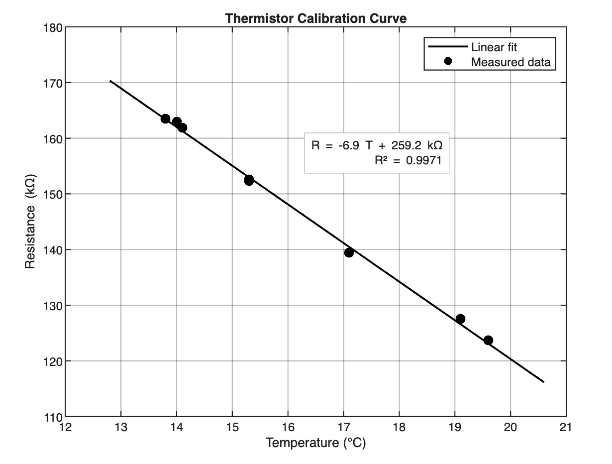
:::
::::

### 3. Mechanical integration & payload

The electronics and the 12 V battery sit in a sealed box on the deck. The solar cell, thermistor, and pressure tube are built into a 3D-printed payload. Foam pool noodles around the frame keep the robot stable.

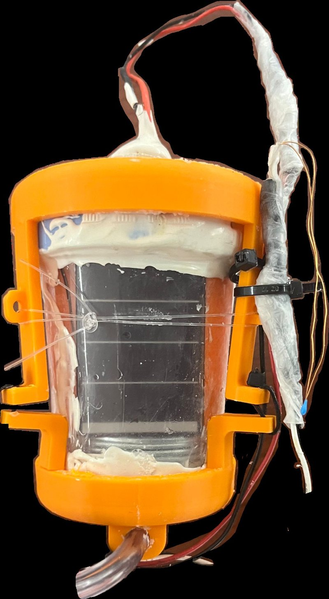{width="45%" fig-align="center"}

### 4. Deployment & data processing

The Teensy runs a stepped descent: the winch lowers the payload for 3 seconds, then pauses for 3 seconds, until it reaches maximum depth, then reels it back up. Afterwards we decoded the SD-card log in MATLAB.

:::: {.media-grid}
::: {}
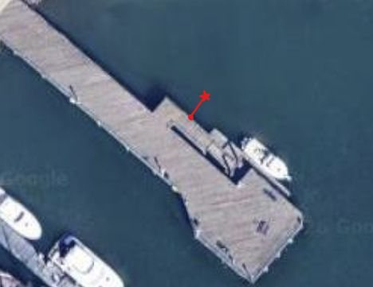
:::
::: {}
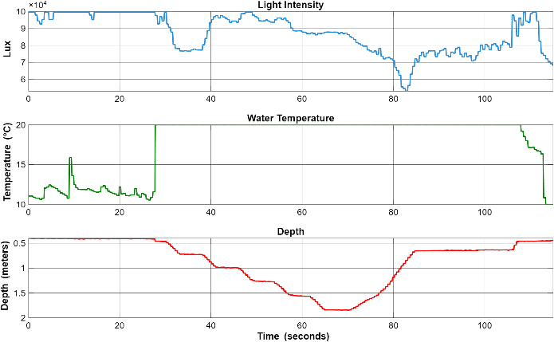
:::
::::

## Why We Made These Decisions

:::: {.decisions}
::: {.decision}
#### Inverting offset amplifier (gain −11.5)
[Why:]{.why} The pressure sensor's raw output only moved from about 0.85 V to 1.01 V over 2 m. Amplifying and offsetting it maps the surface to about 2.7 V and maximum depth to about 1.0 V, using far more of the ADC's resolution.
:::
::: {.decision}
#### Unity-gain buffers first
[Why:]{.why} The buffer isolates each sensor from the amplifier stage, so the gain circuit doesn't load the sensor and distort its reading.
:::
::: {.decision}
#### Solar cell wired straight to the ADC
[Why:]{.why} Its open-circuit voltage tops out around 3.3–3.4 V, already matching the ADC range. The Teensy's high input impedance means the cell runs unloaded, so no extra circuitry was needed.
:::
::: {.decision}
#### Stepped descent (3 s move / 3 s pause)
[Why:]{.why} The pauses give the sensors time to settle at each depth, and they keep readings away from electrical noise from the running motor. You can see the steps in the depth plot.
:::
::: {.decision}
#### Winch motor at 3 V
[Why:]{.why} Lifting the payload needs about 0.29 lb·in of torque. At 3 V the motor still gives about 8.25 in·lb, a large margin, at about 30 RPM. That gives a slow, controlled 2.35 in/s descent.
:::
::: {.decision}
#### Foam floats on a PVC frame
[Why:]{.why} The floats around the perimeter keep the center of buoyancy well above the center of mass, so the robot resists capsizing while the winch works.
:::
::::

## Results

:::: {.result-stats}
::: {.result-stat}
**1.84 m**
[Max payload depth]{}
:::
::: {.result-stat}
**~100k → 88k lux**
[Light, surface to max depth]{}
:::
::: {.result-stat}
**R² = 0.999**
[Pressure calibration]{}
:::
::: {.result-stat}
**10 Hz**
[Synchronized logging]{}
:::
::::

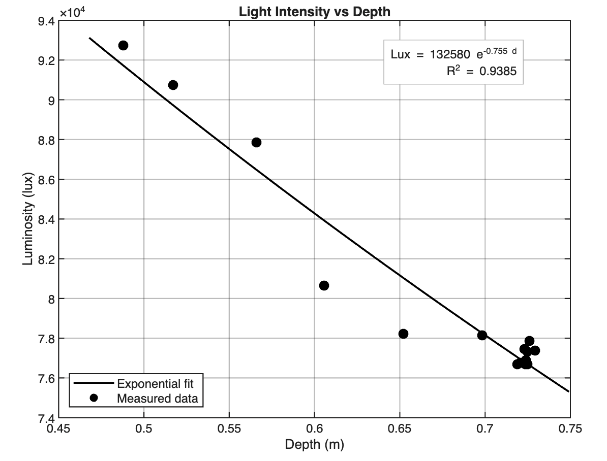{width="70%" fig-align="center"}

* The robot deployed at Dana Point Harbor and recorded synchronized depth, light, and temperature data.
* The depth trace clearly shows the programmed descent steps.
* Light dropped steeply with depth, as theory predicts for a coastal harbor.
* **What failed:** saltwater got past the thermistor's epoxy and shorted it, so its reading jumped to the maximum (railed) about 25 seconds into the dive. The same epoxy had held up in freshwater testing at pHake Lake.

## What I Learned & Would Improve

::: {.improve}
Iterating on these:

* **Waterproof for saltwater, not just freshwater.** Use fortified epoxy around the thermistor and seal every electrical connection, then validate the sensors in saltwater before deploying.
* **Keep the solar cell facing up.** The cell likely flipped on the way back up, producing false low readings.
* **Avoid saturation near the surface.** The unloaded cell clips at our 100,000 lux limit in bright sun.
* **Tune sampling timing** for more stable readings at each depth step.
:::

[Read the full report (PDF)](E80_Final_Report_Ivan_Jimenez_Pineda.pdf){.btn .btn-primary target="_blank"} [View the poster (PDF)](E80_Poster.pdf){.btn .btn-outline-primary target="_blank"} [← Back to all projects](engineering_projects.qmd){.btn .btn-outline-primary}
