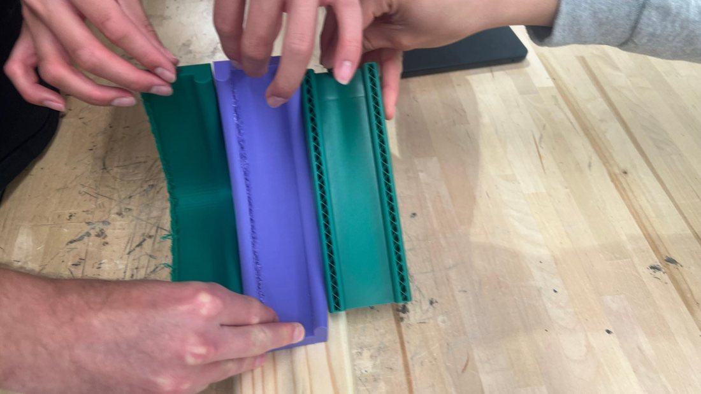
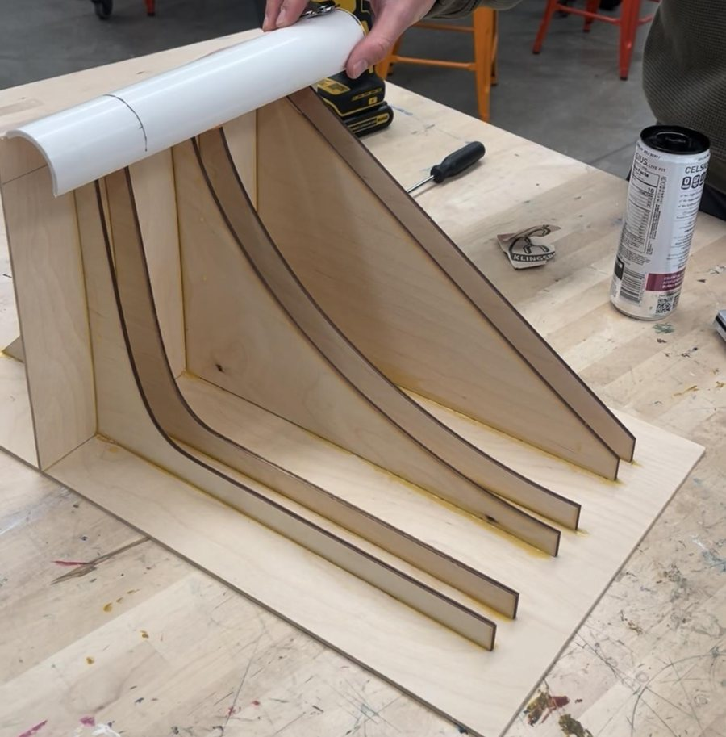
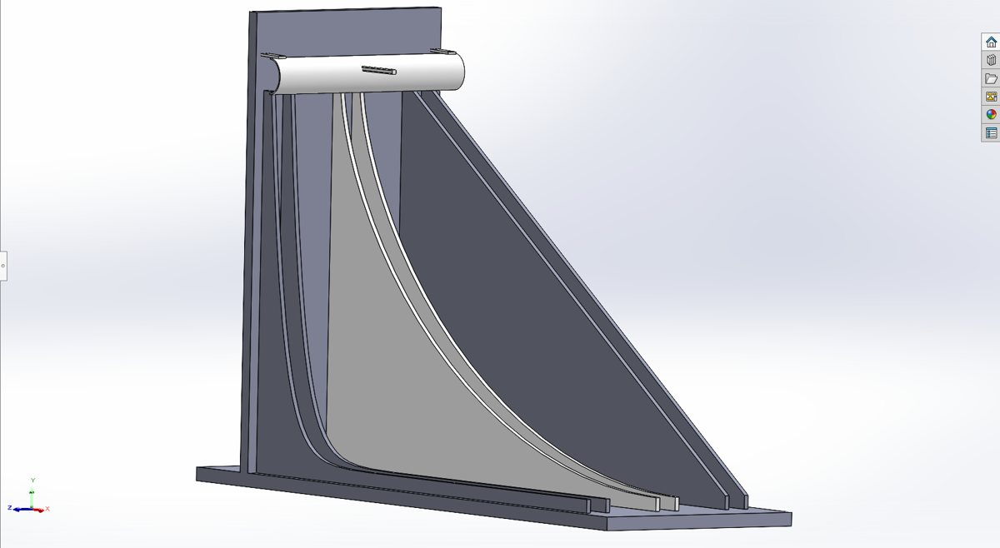
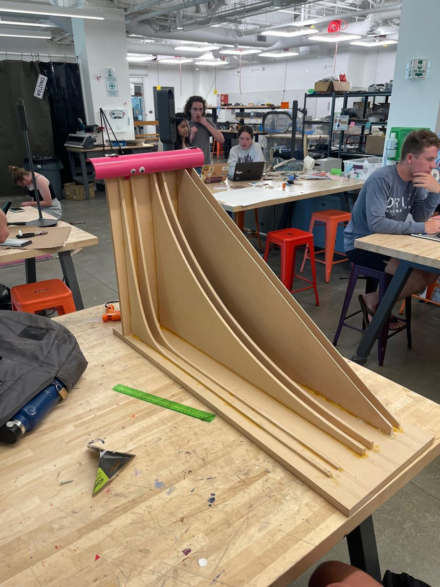

:::: {.glance}
::: {.glance-item}
[Context]{.glance-k}
Client-based design project for a professor's classroom demonstration. Team Kirby, 5 students. Feb – May 2025.
:::
::: {.glance-item}
[My Role]{.glance-k}
SolidWorks modeling of the curves, plus CNC router certification and fabrication of the final model's curves, base, and back wall.
:::
::: {.glance-item}
[Tools]{.glance-k}
Desmos · SolidWorks (Equation Driven Curves) · 3D printer · Laser cutter · CNC router · Belt & hand sanders · Bandsaw
:::
::: {.glance-item}
[Status]{.glance-k}
[Completed]{.status .status--done}
<br>[Design]{.skill .skill--design} [Build]{.skill .skill--build} [Analyze]{.skill .skill--analyze} [Iterate]{.skill .skill--iterate} [Communicate]{.skill .skill--communicate}
:::
::::

## Context

A **brachistochrone** is the curve of fastest descent between two points, and it isn't a straight line: it's a cycloid. Our client, a professor, wanted a physical **brachistochrone race** for class. A ball on the brachistochrone races a ball on a straight line and a ball on a third curve with a large dip, so students can see which path wins.

**Client requirements:**

* Show that the brachistochrone mimics a cycloid.
* Large enough to be seen by a large class.
* Durable enough to be reused in future years of the class.
* Transportable between classrooms.

**Constraints we designed to:**

| Constraint | Why the client needed it | Final result |
|---|---|---|
| Weigh under 40 lb | One person carries it | **20.7 lb** |
| Fit on a cart | Moved between classrooms | One person carries it from the ends; it fits on a cart |
| Survive repeated use | Used for many years | **Zero damage after 20 test uses** |

## My Role

Our five-person team shared the design work. My contributions:

* **CAD:** I modeled the descent paths in SolidWorks with the **Equation Driven Curve** feature, so each curve follows its exact equation.
* **CNC fabrication:** I was one of two teammates who got **CNC router certified** so we could build the larger final model. I CNC-routed the MDF curves, the base and back wall, and the custom corner fixtures, keeping assembly precise and in tolerance.

## What We Built

Three side-by-side tracks:

* a **mathematically accurate brachistochrone (cycloid)**,
* a **straight line**, and
* a **20th-degree polynomial with a steep dip** (labeled "Exponential" in the video).

Each track is two thin MDF rails about 1 inch apart, so the ball rolls in the gap between them. A hinged, pink PVC gate releases all three balls at the same instant.

```{=html}
<div class="video-frame" style="max-width: 900px;">
  <video controls muted playsinline loop preload="metadata" poster="images/projects/brachistochrone/race_video_poster.jpg">
    <source src="videos/brachistochrone_race.mp4" type="video/mp4">
  </video>
</div>
<p class="video-cap">The final model in real time: all three balls are released together, and the brachistochrone ball wins.</p>
```

## How We Built It: Three Prototypes

We iterated through three prototypes, each one answering a question from the last.

:::: {.media-grid}
::: {}

:::
::: {}

:::
::: {}

:::
::::

::: {.steps}
1. **Prove the math (Prototype 1).** We plotted the curves in Desmos, modeled them in SolidWorks, and 3D printed a small PLA version. It behaved close to the predictions, which confirmed the curve equations. The next priorities were a smoother, lower-friction surface and a simultaneous release.
2. **Improve friction and visibility (Prototype 2).** We laser cut each curve twice from ¼-inch plywood and glued the two cuts about 1 inch apart, so the ball rides between two thin rails instead of in a walled channel. A half PVC pipe on two hinges released all the balls together.
3. **Scale up (final).** The client told us visibility mattered more than the original size limit, so we went bigger. I got CNC router certified, and we routed ¾-inch MDF planks down to ¼ inch, cutting two of each curve plus the base and back wall.
4. **Finish and assemble.** We sanded every edge smooth on the belt and hand sanders. Then we laid out the tracks 3 inches apart with a 1-inch gap for the ball, and fixed them with wood and hot glue.
5. **Build the release gate.** We cut a 2-inch PVC pipe in half and to 12 inches on the bandsaw, spray painted it pink, and hinged it to the back wall. A small lip lets the steep polynomial curve start at the same moment as the others.
:::

{width="55%" fig-align="center"}

## Why We Made These Decisions

:::: {.decisions}
::: {.decision}
#### Equation Driven Curves instead of sketched splines
[Why:]{.why} The whole demonstration depends on each curve's exact shape. Driving the geometry from the equations keeps the cycloid mathematically accurate, where a hand-fit spline could change the descent times.
:::
::: {.decision}
#### A cheap printed prototype first
[Why:]{.why} Printing a small PLA version tested the curve math quickly before we spent time and material on a large build.
:::
::: {.decision}
#### Twin "floating ball" rails instead of a walled ramp
[Why:]{.why} The ball touches only two thin edges, which cuts friction. Students can also see more of the ball from across a large classroom.
:::
::: {.decision}
#### MDF, CNC-routed
[Why:]{.why} MDF is wear resistant, so it suits a model used for years. The CNC router reproduces the CAD curves accurately at a size too large for our laser cutter.
:::
::: {.decision}
#### Hinged gate with a lip
[Why:]{.why} A fair race needs every ball to start at the same instant. The extra lip makes up for the steep start of the polynomial curve.
:::
::: {.decision}
#### Bigger instead of smaller
[Why:]{.why} The client cared most about visibility. A larger model made the finishing order obvious to the naked eye, without slowing down the video.
:::
::::

## Results

We released all three balls together five times and timed each run from video.

| Curve | Predicted | Trial 1 | Trial 2 | Trial 3 | Trial 4 | Trial 5 | **Average** |
|---|---|---|---|---|---|---|---|
| **Brachistochrone** | Fastest | 0.71 s | 0.71 s | 0.71 s | 0.70 s | 0.69 s | **0.704 s** |
| 20th-degree polynomial | Middle | 0.82 s | 0.82 s | 0.81 s | 0.81 s | 0.82 s | **0.816 s** |
| Linear | Slowest | 0.92 s | 0.90 s | 0.89 s | 0.89 s | 0.90 s | **0.900 s** |

:::: {.result-stats}
::: {.result-stat}
**5 / 5**
[Races won by the brachistochrone]{}
:::
::: {.result-stat}
**~0.2 s**
[Faster than the straight line]{}
:::
::: {.result-stat}
**~0.1 s**
[Faster than the polynomial]{}
:::
::: {.result-stat}
**20.7 lb**
[Under the 40 lb limit]{}
:::
::::

* The finishing order matched our predictions in every trial: brachistochrone first, polynomial second, straight line last.
* The model scored the top mark (5/5) on our accuracy metric: "brachistochrone is clearly the fastest curve."
* We delivered it to the client ready to use, with balls included (and googly eyes, for fun).

## What I'd Improve

::: {.improve}
Next iteration:

* **Reduce friction and air resistance** so the measured times get closer to the ideal, frictionless predictions.
* **Compare against theory.** Calculate the predicted descent time for each curve and report the percent error alongside the finishing order.
:::

[← Back to all projects](engineering_projects.qmd){.btn .btn-outline-primary}
