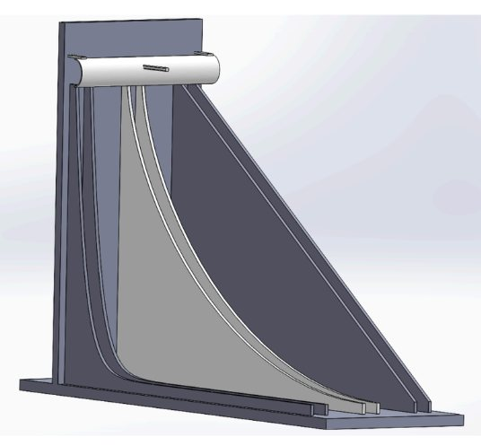
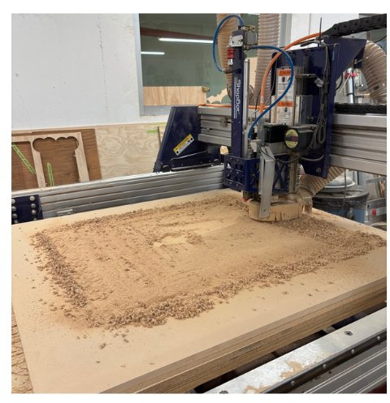
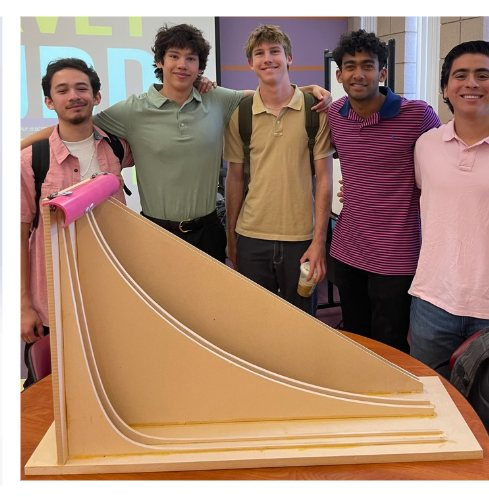

:::: {.glance}
::: {.glance-item}
[Context]{.glance-k}
Team project for a client who requested a physics demonstration. Feb – May 2025.
:::
::: {.glance-item}
[My Role]{.glance-k}
CAD modeling of the descent paths in SolidWorks, and CNC-router fabrication of the ramps and corner fixtures.
:::
::: {.glance-item}
[Tools]{.glance-k}
SolidWorks (Equation Driven Curves) · CNC router · Shop assembly
:::
::: {.glance-item}
[Status]{.glance-k}
[Completed]{.status .status--done}
<br>[Design]{.skill .skill--design} [Build]{.skill .skill--build} [Communicate]{.skill .skill--communicate}
:::
::::

## Context

A **brachistochrone** is the curve of fastest descent between two points. Surprisingly, it isn't a straight line but a cycloid. Our client asked for a physical demonstration that makes this visible: balls released at the same moment race down different paths, and the audience can see which path wins.

**Parameters:** the model had to clearly demonstrate kinematic principles to an audience, so the curve geometry had to be accurate, the tracks smooth and consistent, and the whole model sturdy enough to use repeatedly.

## My Role

* **CAD:** I modeled the descent paths in SolidWorks with the **Equation Driven Curve** feature.
* **Fabrication:** I cut the primary ramp structures and custom corner fixtures on a **CNC router**, keeping assembly precise and within tolerance.

## What We Built

Three side-by-side tracks cut into wooden ramp panels, labeled in the demo video as **Linear**, **Brachistochrone**, and **Exponential**. A release at the top starts all three balls together.

```{=html}
<div class="video-frame" style="max-width: 900px;">
  <video controls muted playsinline loop preload="metadata" poster="images/projects/brachistochrone/race_video_poster.jpg">
    <source src="videos/brachistochrone_race.mp4" type="video/mp4">
  </video>
</div>
<p class="video-cap">The finished model in action: three balls released together race down three different paths.</p>
```

## How We Built It

:::: {.media-grid}
::: {}

:::
::: {}

:::
::: {}

:::
::::

::: {.steps}
1. **Model each path from its equation** using SolidWorks' Equation Driven Curve feature.
2. **Lay out the ramps and corner fixtures** as parts that can be cut on the CNC router.
3. **CNC-route the ramp structures and fixtures** so each curve matches the CAD profile.
4. **Assemble, test with the balls, and demonstrate** the race to the client.
:::

## Why We Made These Decisions

:::: {.decisions}
::: {.decision}
#### Equation Driven Curves instead of sketched splines
[Why:]{.why} The whole demonstration depends on the exact shape of each path. Driving the geometry from the curve equations keeps the cycloid mathematically accurate, where a hand-fit spline could change the descent times.
:::
::: {.decision}
#### CNC router instead of hand cutting
[Why:]{.why} A router reproduces the CAD profile directly, giving smooth, consistent curves that are very hard to cut accurately by hand. Any bumps in a track would slow the ball and spoil the comparison.
:::
::: {.decision}
#### Custom corner fixtures
[Why:]{.why} The fixtures hold the ramp structures square and aligned during assembly, so the tracks stay where the CAD put them.
:::
::: {.decision}
#### Tracks side by side, released together
[Why:]{.why} Viewers can compare all three paths at once in a single run, which makes the physics obvious without any timing equipment.
:::
::::

## Results & Next Iteration

The model was completed and demonstrated to the client: three balls run side by side down the three paths in a single release (see video).

::: {.improve}
If I iterated on this design, I would:

* **Add timing.** Photogates at the finish would measure each descent time to compare against theory.
* **Quantify losses.** Compare measured times with predicted times to see how much rolling friction and track contact matter.
:::

[← Back to all projects](engineering_projects.qmd){.btn .btn-outline-primary}
