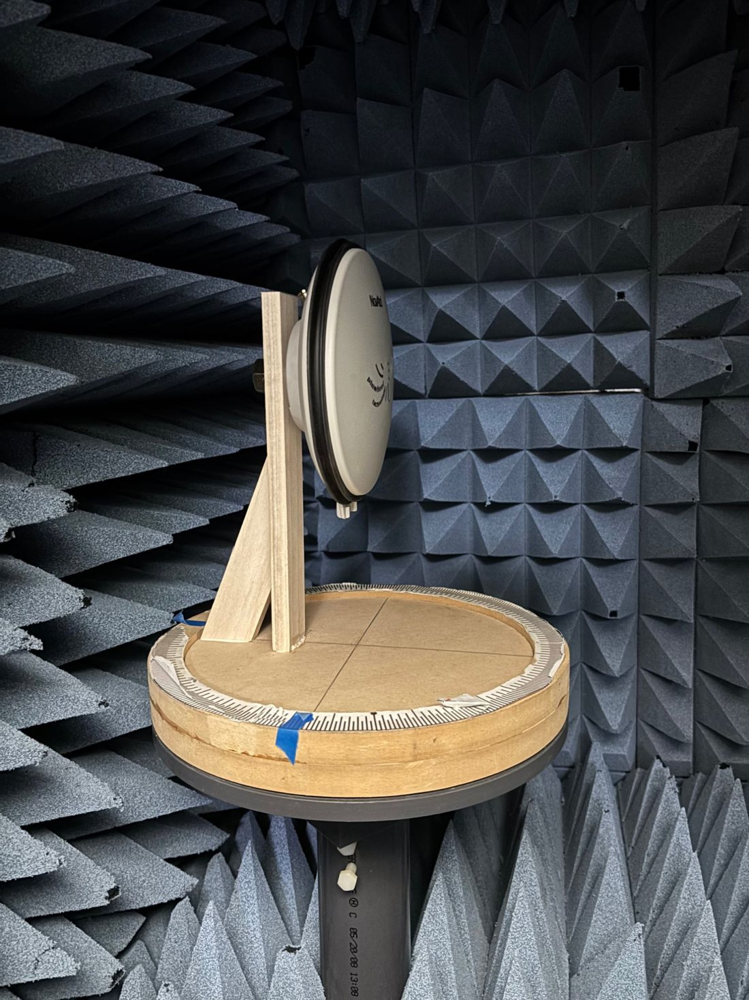
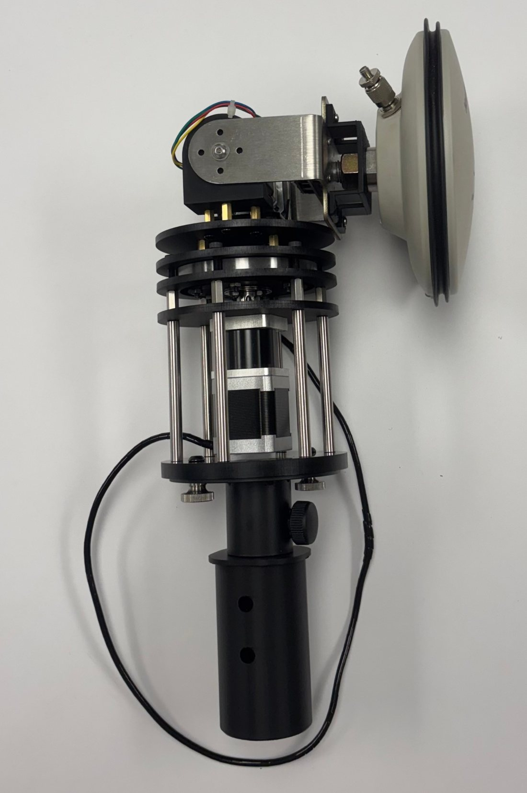
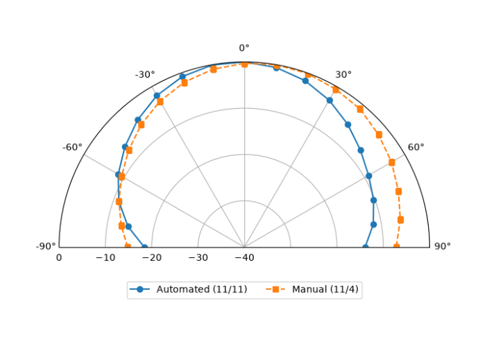

::: {.in-progress-banner}
[In Progress]{.status .status--progress}

This is an active project (September 2026 – present). What you see here is the current state, plus the next steps and areas I'm improving.
:::

:::: {.glance}
::: {.glance-item}
[Context]{.glance-k}
Harvey Mudd Engineering Clinic, sponsored by The Aerospace Corporation and the FAA. Team project.
:::
::: {.glance-item}
[My Role]{.glance-k}
Lead for automating the antenna positioner, and member of the mechanical team that designs, assembles, and implements the mount and positioner.
:::
::: {.glance-item}
[Tools]{.glance-k}
Python · Raspberry Pi · ESP32 · AntRunner positioner · Vector Network Analyzer · Woodworking · Manual machining
:::
::: {.glance-item}
[Skills Shown]{.glance-k}
[Design]{.skill .skill--design} [Build]{.skill .skill--build} [Analyze]{.skill .skill--analyze} [Iterate]{.skill .skill--iterate}
:::
::::

## Context

Our clinic team is helping The Aerospace Corporation and the FAA evaluate a **Controlled Reception Pattern Antenna (CRPA)**, a GPS anti-jamming antenna, to inform whether CRPAs can be used for commercial aviation safety. The end goal is element-level and array-level characterization of the CRPA inside an anechoic chamber.

Before testing the CRPA, we are validating our measurement process on a simpler **Fixed Reception Pattern Antenna (FRPA)**, a NovAtel GPS antenna. Measuring a radiation pattern means pointing the antenna at many known angles and recording its response with a **Vector Network Analyzer (VNA)** at each one. That requires two things:

* a way to hold the antenna securely in the chamber, and
* a way to set its angle accurately and repeatably.

## My Role

I'm leading the **automation of the AntRunner positioner**, the motorized mount that rotates the antenna through each angle. I'm also on the **mechanical team**. My responsibilities:

* **Software:** writing the Python control script that drives the positioner's rotors, run from a Raspberry Pi that sends commands to the AntRunner's ESP32 controller.
* **Mechanical team:** supporting the design, assembly, and implementation of the antenna mount and positioner in the chamber.
* **Electrical setup:** wiring and powering the AntRunner and antenna inside the chamber.
* **Manual baseline:** I built the wooden mount used for our first, hand-rotated FRPA radiation-pattern test.
* **Fixturing and RF testing:** machining mounting fixtures for the positioning turntables and running benchtop VNA measurements with dual probe antennas.

## What I Built

We've measured the FRPA's radiation pattern two ways, so we can compare a manual setup against an automated one.

:::: {.media-grid}
::: {}

:::
::: {}

:::
::::

## How It Works

The Python script runs a raster sweep: it steps across azimuth at a fixed elevation, then raises the elevation and sweeps again.

```{=html}
<div class="video-frame video-frame--portrait">
  <video controls muted playsinline preload="metadata" poster="images/projects/clinic/frpa_video_poster.jpg">
    <source src="videos/frpa_automated_test.mp4" type="video/mp4">
  </video>
</div>
<p class="video-cap">Automated FRPA test in the anechoic chamber: 10° azimuth steps every 3 seconds from −90° to +90°, then a 10° elevation step.</p>
```

::: {.steps}
1. **Build a manual baseline.** I built a wooden mount and ran a hand-rotated pattern measurement with the VNA (Nov 4).
2. **Mount the AntRunner in the chamber.** The positioner slides into an adapter tube on the chamber mast and is clamped with thumbscrews. The FRPA bolts to the elevation bracket.
3. **Write the control script.** Python on a Raspberry Pi sends move commands to the AntRunner's ESP32, which drives the rotors.
4. **Run the raster sweep.** The script steps azimuth by 10° every 3 seconds from −90° to +90°. It then raises elevation by 10°, returns to −90° azimuth, and repeats.
5. **Compare the automated and manual patterns** (Nov 11) to see whether automation improves the measurement.
:::

## Why I Made These Decisions

:::: {.decisions}
::: {.decision}
#### Wood for the manual mount
[Why:]{.why} Metal near an antenna can reflect and distort the signal being measured. Wood is RF-quiet, cheap, and fast to cut, which suited a first baseline test.
:::
::: {.decision}
#### Test the FRPA before the CRPA
[Why:]{.why} The FRPA is a simpler antenna, so it lets us debug the chamber setup, the positioner, and our process before spending test time on the sponsor's CRPA.
:::
::: {.decision}
#### Automate the positioning
[Why:]{.why} Turning the table by hand and reading a printed scale is slow and adds angle error at every point. A motorized positioner hits the same angles every run and can also sweep elevation, which is impractical by hand.
:::
::: {.decision}
#### Raspberry Pi + ESP32
[Why:]{.why} The ESP32 handles low-level motor control on the AntRunner. The Raspberry Pi runs the high-level Python test script, which is easy to edit as the test plan changes.
:::
::: {.decision}
#### 10° steps with a 3-second dwell
[Why:]{.why} This balances angular resolution against total test time. The pause lets the antenna settle after each move before a reading is taken.
:::
::: {.decision}
#### Always sweep from −90° upward
[Why:]{.why} Returning to −90° before each new elevation row means every row is measured in the same direction, so any slack in the drive affects every row the same way.
:::
::::

## Results So Far

{width="80%" fig-align="center"}

* Both methods show the expected shape: strongest response at boresight (0°), rolling off toward ±90°.
* The manual test reads noticeably higher on the +60° to +90° side than on the matching negative angles.
* The automated sweep is much more symmetric about 0°, which is closer to what we expect from this antenna.

Automating the positioner made the pattern measurement more consistent, and it is now the basis for our CRPA test plan.

## Next Steps & Areas for Improvement

::: {.improve}
This project is still in progress. These are the areas I'm working on next:

* **Log VNA data automatically.** Tie VNA data capture into the Python script, so each measurement is saved with its commanded angle and there's no manual transcription.
* **Prove repeatability.** Run repeated sweeps of the same antenna and report the spread at each angle (error bars), not just a single pattern.
* **Keep the antenna on the rotation axis.** The FRPA currently sits off to one side of the positioner. A centered adapter would keep the antenna in place as it rotates, instead of swinging it around.
* **Clean up the RF environment.** Route and secure the coax and USB cables away from the antenna, give the battery pack a proper mount, and cover nearby metal (motor, brackets) with absorber to reduce reflections.
* **Increase resolution where it matters.** Use finer steps near boresight, and combine all elevation rows into a full 2-D pattern map.
* **Move to the CRPA.** Apply the validated process to element-level and then array-level characterization of the CRPA.
:::

[← Back to all projects](engineering_projects.qmd){.btn .btn-outline-primary} [See this role in Professional Experience](professional_experience.qmd#crpa){.btn .btn-outline-primary}
